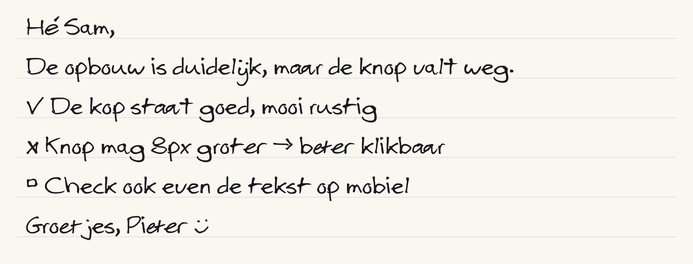
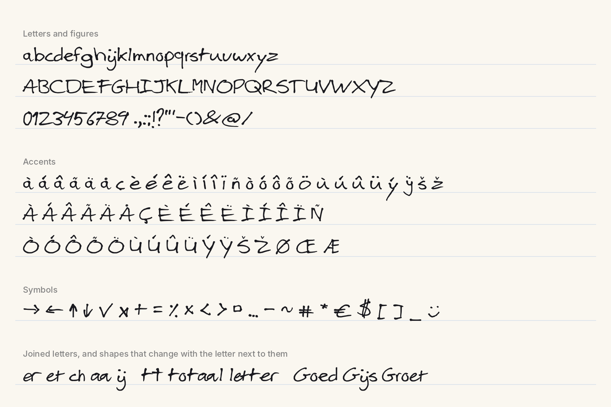

# PDK Hand

Pieter de Kroon's handwriting as a font. Written on paper with an Edding 141F, photographed, and turned into outlines by the scripts in this repository. Part of the [PDK design system](https://design.pieterdekroon.com).



## Files

| File | For |
|---|---|
| `fonts/otf/PDKHand-Edding141F.otf` | Installing on a Mac or PC: Figma, Keynote, Word |
| `fonts/ttf/PDKHand-Edding141F.ttf` | Apps on Windows that work better with TrueType |
| `fonts/webfonts/PDKHand-Edding141F.woff2` | Websites, with `@font-face` |

Family **PDK Hand**, style **Edding 141F**. A new pen becomes a new style in the same family.

## What is in it



- a to z, A to Z, 0 to 9, punctuation, and the accented letters of Western European languages.
- Symbols for feedback: → ← ↑ ↓ ✓ ✗ + = % × < > • … – ~ # * € $ [ ] _
- Letters Pieter joins when he writes stay joined: er, et, ch, aa and ij. oo, sch and IJ are there too, under discretionary ligatures, because they read worse in running text.
- t, er, et, G and Z have more than one shape. The font picks one by the letter before it (lowercase) or after it (capitals), so two in a row never look the same.
- Type ◡̈ (◡ followed by a combining diaeresis) or ☺ for the smiley.

## How it is built

```
sources/photos/   the pages, as photographed
scripts/segment.py   photo → black and white ink, cut into rows and glyphs (segments/, not in git)
scripts/build.py     picks the letters, evens out size and stroke, traces them and writes the fonts
scripts/extra.py     symbols, accents and the accented letters made from them
scripts/specimen.py  the images in specimen/
```

```bash
pip install -r requirements.txt
./build.sh
```

To replace a letter: photograph a new page, add it to `PHOTOS` in `segment.py`, run it, find the letter's number in `segments/<photo>/vis.jpg` (row.group, like `1.8`), and point to it in `build.py`. Then build again and raise `VERSION`.

## Versions

See [CHANGELOG.md](CHANGELOG.md). The version is in the font itself (Font Book shows it).

## License

Copyright 2026 Pieter de Kroon. All rights reserved. This is a person's handwriting: it is not free to use, copy or share without written permission. See [LICENSE.txt](LICENSE.txt).
